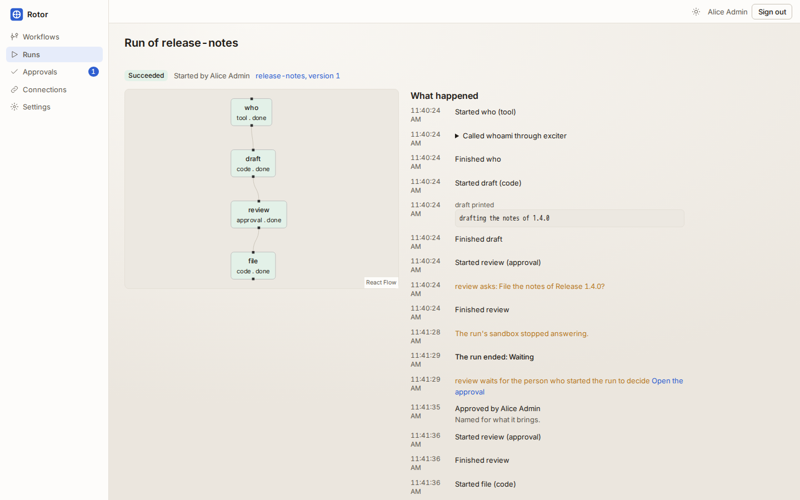
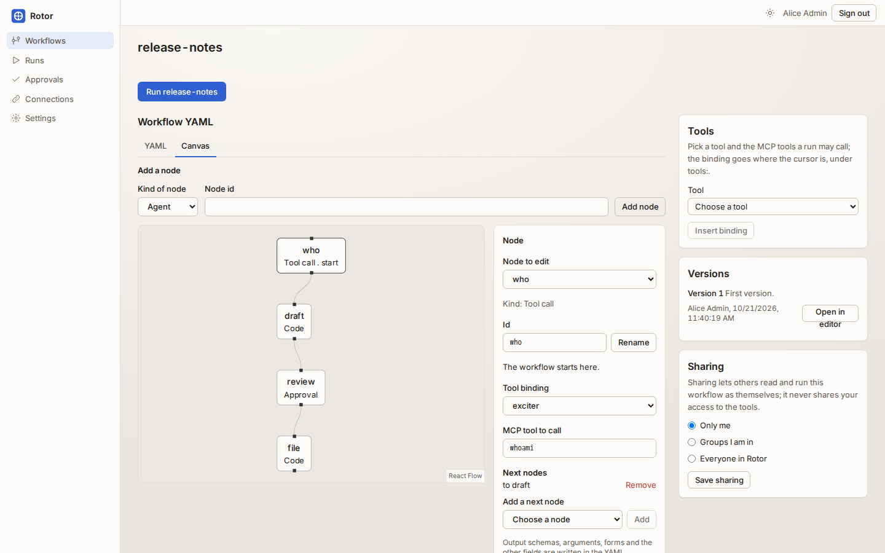
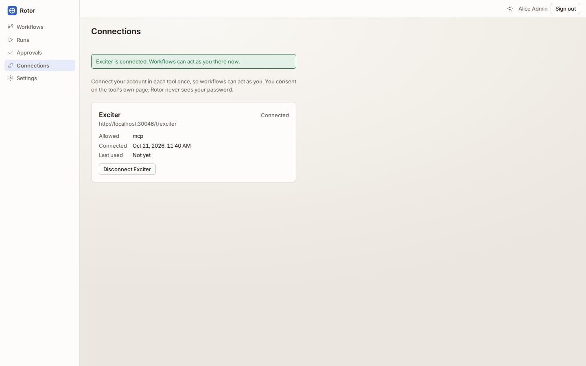
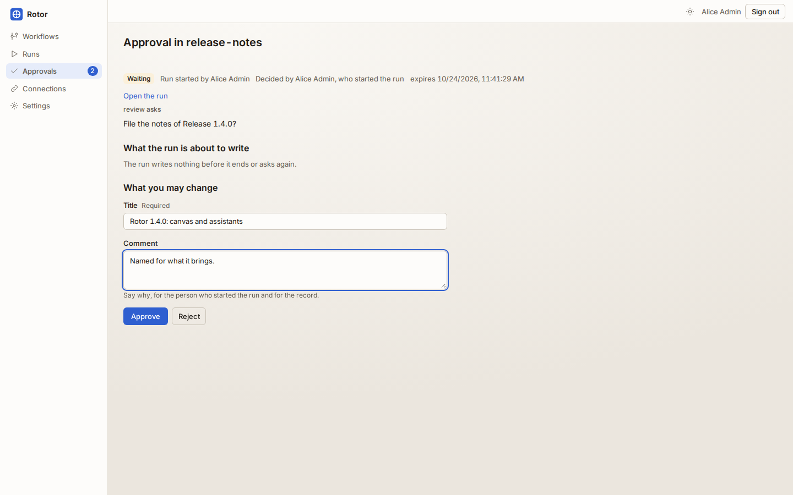
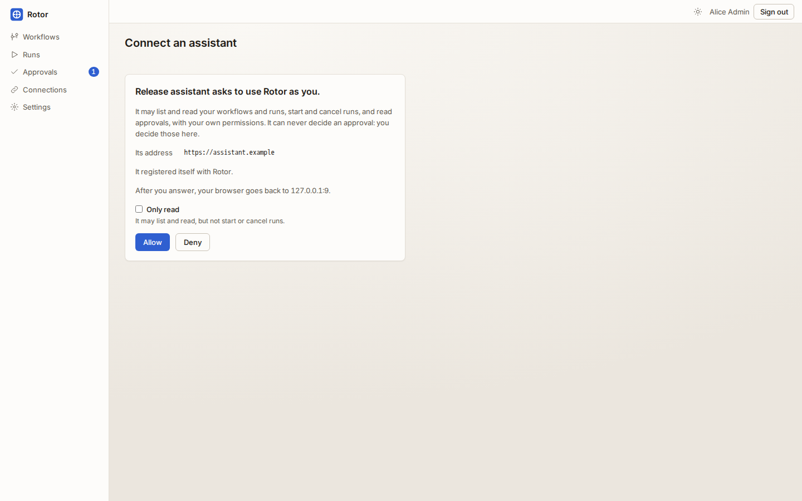

<p align="center"></p>

# Rotor

**Workflows that act in Exciter, Armature and Stator as the person who starts
them**, self-hosted: the agentic backplane of the suite. A workflow strings
together model agents, MCP tool calls, Python and approvals; people start it
by hand, on a schedule or from a tool's event, and watch every step. Each run
executes in a sandbox of its own, holds only short-lived tokens the tools
minted for it, and stops for a person before it writes where the workflow
says so.

[](LICENSE)
[](backend/go.mod)
[](runner/pyproject.toml)
[](runner/pyproject.toml)
[](web/package.json)
[](backend/migrations)
[](deploy/charts/rotor)



A Go control plane (the api and the worker), a Python runner on LangGraph
started in a sandbox per run, a React SPA, PostgreSQL, Valkey and OpenBao.
People sign in with their suite account through the realm Exciter, Armature
and Stator share, and share workflows by group. Pre-1.0: it runs, every
layer is tested on every pull request, and releases are cut by
[semantic version](#releasing) with what changed in
[`CHANGELOG.md`](CHANGELOG.md); the
[milestones](https://github.com/Cloudster1/Rotor/milestones) set out the path.

This file is how to run it, test it and operate it. What it does is summarised
below and argued in [`docs/decisions.md`](docs/decisions.md); how it is built
is [`docs/architecture.md`](docs/architecture.md); what it protects and from
whom is [`docs/threat-model.md`](docs/threat-model.md); the product in
pictures is [`docs/screenshots.md`](docs/screenshots.md). Writing a workflow
is [`docs/workflows.md`](docs/workflows.md), starting one without anyone
pressing Run [`docs/triggers.md`](docs/triggers.md), connecting an assistant
[`docs/assistants.md`](docs/assistants.md), and what Rotor promises the rest
of the suite [`docs/integration.md`](docs/integration.md).

## Running it

Every toolchain runs in a container. There is no Go, Python, Node or Postgres
to install; the host needs Docker, make, `jq` and `python3`.

```sh
git clone https://github.com/Cloudster1/Rotor.git && cd Rotor
make up      # postgres, valkey, keycloak, openbao, the tool stub, the api,
             # the worker, the web client and the runner image, and where each listens
```

Open the web address `make up` prints and sign in with your suite account:
the stack runs a Keycloak with the realm `dynamo` that Exciter, Armature and
Stator import too, from the same `deploy/keycloak/realm.json`. Its people sign
in with their name and the word password, `alice` / `alice password` and so
on. alice is in `rotor-administrators` and administers Rotor; bob is in
`engineering`, carol in `quality`, dave in `marketing`, and each is a member.
The admin console is `admin` / `admin`. `make realm-check` compares the realm
with Dynamo's canonical copy, leaving Rotor's own clients aside until Dynamo
carries them.

Every port is bound to `127.0.0.1` and derived from the checkout's path, so
worktrees and the siblings' stacks run side by side; `make ports` prints them
and `.cache/stack.env` keeps them. The stack's `tool-stub` stands in for the
tools: every `/t/<name>` on its port is a tool of its own that behaves as
Exciter does, or as Armature for `/t/armature--<name>`, with a stub model under
`/t/<name>/llm/v1`.

For something to look at, `make screenshots` against a fresh stack does what a
first afternoon would: it adds the tool stub as Exciter and its stub model,
connects alice, saves two workflows and carries runs through an approval,
taking the pictures in [`docs/screenshots.md`](docs/screenshots.md) as it
goes. To try the real thing, `make suite-up` starts Exciter and Armature, from
the commits in `deploy/suite/EXCITER_REF` and `ARMATURE_REF`, beside the
stack, signing in through the same Keycloak; Armature comes with a project
`CP` in which alice and bob work and dave only reads.

```sh
make help              # every target
./run-tests.sh         # the whole gate, as CI and the push hook run it
make observe           # the stack with a collector, Jaeger and Prometheus
make down              # stop      (make clean also drops the volumes)
```

The compose stack is for development: it publishes every port on `127.0.0.1`
only, its passwords are in the file and [`SECURITY.md`](SECURITY.md) lists
them, and its worker starts sandboxes through the host's Docker socket. A
deployment changes all of that, and [the chart](#deploying-it) is where it is
written down.

## What it does

Each of these is argued in [`docs/decisions.md`](docs/decisions.md), which is
the reference for why.

**Workflows.** A workflow is YAML, checked against
[`api/workflow.v1.schema.json`](api/workflow.v1.schema.json) and against the
tools as the person saving it sees them. Its nodes are agents (a model that
may call its bindings' tools), single tool calls, Python code nodes,
approvals and routers; its inputs are a JSON Schema the Run dialog asks for;
its limits bound steps, time, tokens, cost and concurrent runs. Every save is
an immutable, numbered version a run pins, and any two versions compare. A workflow is its author's, shared with groups or with everyone, and
sharing it never shares its author's access. The editor completes from the
schema, and its Canvas tab draws the same workflow, writing every change into
the YAML so the YAML tab shows what you could have written yourself.



**Runs.** Each run executes in a sandbox of its own: the runner compiles the
pinned version into a LangGraph graph, dials the control plane over gRPC with
a single-use token, and keeps its checkpoints there. A sandbox that dies is
replaced and the run resumes from its last checkpoint, up to three sandboxes a
run. The run's page draws its graph coloured by what happened and tells the
same events in words beside it, live, with tool calls folded open on request;
a run can be cancelled at any step.

**As the person, never more.** An administrator adds a tool by its address;
Rotor finds its MCP endpoint and authorization server and registers as its
OAuth client. Each person connects once on the tool's own consent page; the
refresh token goes to OpenBao and never to the database. A run asks for a
token per binding as it needs one, minted for the person who started it,
narrowed to the binding's scopes, handed over wrapped to open once, and
revoked when the run ends. A binding that reads offers only the tools that say
they only read, however a prompt or the content a run reads is worded.



**Approvals.** A run that reaches an approval stops, and its sandbox and
tokens go. The approval shows its message, a preview of what the run may
write before it asks again, and a form of the values an approver may change.
The person who started the run decides, or only the members of the group the
node names; one nobody decides expires. The Approvals inbox lists what waits
for you, with a badge in the sidebar.



**Triggers.** A person starts a workflow on a schedule, cron fields read in a
time zone, or when Armature, Exciter or Stator delivers an event: signed with
the tool's secret, within five minutes, and seen once. A triggered run acts as
its trigger's owner, only while their account, connection and consent last,
and, for now, only on a workflow whose every write comes after an approval.

**Models and what they cost.** Administrators add providers (Anthropic,
OpenAI, Azure OpenAI or any OpenAI-compatible endpoint), keep their keys in
OpenBao and price each model. Usage is totalled per run, person and UTC day; a
workflow bounds its own tokens, cost, concurrency and tool calls a minute, and
administrators bound each person's day. Going over stops the run and says why.

**Text a run reads is data.** Every agent works under a fixed policy, and
every value its prompt quotes and every answer a tool gives it is fenced as
data. A link an agent writes is removed unless it leads to one of the run's
tools, and the editor warns about a workflow that reads untrusted content and
then writes without an approval between.

**Assistants.** Rotor is the OAuth authorization server of its own MCP
endpoint, `/api/v1/mcp`. An assistant such as Claude Code registers, or names
the address of its client ID metadata document, and its person allows it on
Rotor's consent page, to act or only to read. It lists, reads, checks, starts
and cancels workflows and runs as that person, and reads approvals, never
deciding one. Settings lists the assistants each person connected, to
disconnect any, and administrators see everybody's.



**A record of everything.** The audit log keeps who did what, and what Rotor
did on its own: sign-ins, connections, tokens, workflows, runs and their
sandboxes, approvals and triggers, naming the assistant beside the person when
one acted. Nobody, administrators included, changes or empties it; it filters
and exports as CSV or JSON, and the export is recorded too. Each run is one
trace, from the request that started it through the runner's nodes, model
calls and MCP calls.

## How it is put together

```
                      Keycloak, realm "dynamo" (one subject per person across the suite)
                         ^ sign-in (OIDC)              ^ service-account token
                         |                             |
browser --> web (nginx, React SPA) --> api (Go) -------+------> OpenBao
                         ^  SSE          |   |                   (refresh tokens, wrapping,
                         |               |   +--> PostgreSQL      transit, JWT and k8s auth)
                         |               |   +--> Valkey                ^
                         |               |                              | unwrap once,
                         |               v                              | own run's paths only
                         |         worker (Go) --spawn/destroy--> sandbox (one per run)
                         |               ^                        +--------------------------+
                         +---------------+---- gRPC, dialled out --| runner (Python, LangGraph) |
                                                                   +--------------------------+
                                                                      |  MCP over HTTPS, as the person
                                                                      v
                                                     Exciter /mcp   Armature /mcp   Stator /mcp
```

The api serves the SPA's API and the runner protocol; the worker leases queued
runs with `FOR UPDATE SKIP LOCKED`, starts and ends their sandboxes, fires
triggers and sweeps what expired, and any number of either may run. The api
connects as `rotor_app`, which row-level security binds, and as
`rotor_admin`, exempt by policy for sign-in and jobs; neither is a superuser,
and neither may update or delete the audit log. A sandbox is untrusted: it runs the
workflow author's code and reads content attackers may have written, so it
holds only its own run's short-lived tokens, and approvals and write
confirmations are enforced outside it. A run's inputs, output, events,
checkpoints and approvals are sealed with a data key of its own, which only
OpenBao opens. [`docs/architecture.md`](docs/architecture.md) follows each part
in detail.

## Deploying it

[`deploy/charts/rotor`](deploy/charts/rotor) installs the api, the worker and
the web client, runs the roles and migrate Jobs before every upgrade, and
creates the sandbox namespace with its token-less ServiceAccount and the
worker's Role. Postgres, Valkey, OpenBao and Keycloak are yours to supply; the
trial values bring Postgres and Valkey along for a look.

```sh
helm install rotor deploy/charts/rotor -f deploy/charts/rotor/values-trial.yaml \
  --set openbao.addr=http://openbao.example:8200 \
  --set openbao.configure.enabled=true --set openbao.configure.tokenSecret.name=openbao-admin
```

Each release publishes the chart as `oci://ghcr.io/cloudster1/charts/rotor`,
which installs the same way. What a suite installer sets, and the memory the chart and the compose
stack ask for, is in [`docs/integration.md`](docs/integration.md#what-dynamo-needs-to-run-rotor).
The Docker sandbox backend is for development only; a compose server runs
without sandboxes. Three things
[`docs/deployment.md`](docs/deployment.md) explains at length, because each is
a way to get it wrong:

- **Sandboxes run under gVisor.** Every run is a pod under the RuntimeClass
  `sandbox.runtimeClass`, non-root, read-only, without capabilities or a
  ServiceAccount token, in a namespace that enforces the restricted Pod
  Security standard. Without gVisor the chart and Rotor refuse to start
  sandboxes unless `sandbox.allowRunc` says so, and never in production.
  Sandbox egress is denied by default: DNS, the runner port, OpenBao, and the
  tools and the provider you name, by hostname with Cilium.
- **OpenBao is backed up with the database.** It keeps every refresh token,
  provider key and run token, and its transit key wraps every run's data key:
  without it no run's data opens again. It must keep an audit log, and the
  init script refuses one that does not.
- **The images are checked.** Rotor's images are signed keyless by the release
  workflow and carry a signed SBOM; name the runner by digest, and with
  sigstore's policy-controller installed the cluster refuses a sandbox whose
  image a release did not sign.

`tests/test-helm.sh` lints the chart, renders a trial and a production install,
checks what it must refuse and compares the renders with the golden files in
`tests/helm/`. `make kind-up && make test-chart-install` installs it from
signed images into a throwaway kind cluster running Cilium, carries runs in
sandbox pods, tries what a sandbox may and may not reach, and upgrades in
place.

## Testing

`./run-tests.sh` runs every layer of the gate, and `./run-tests.sh --list`
names them; each layer tests something the one below cannot.

| Layer | What it covers |
|---|---|
| `shell` | The tooling itself: the stack's definition, ports, the branch guard, CI, releasing, the chart and the realm |
| `check-format` | Biome over `web/` and `e2e/` |
| `check-go` | gofmt, vet, the Go unit tests with the race detector (the tool stub's contract test among them), OpenAPI and runner protocol drift |
| `check-python` | ruff, mypy and pytest over the runner, and a smoke run of its image with no network |
| `check-web` | eslint, TypeScript, Vitest and the web client's API types |
| `test-integration` | The Go stack against the running compose stack: Postgres with row-level security, OpenBao, Valkey, real sandboxes, the HTTP API through its router |
| `test-e2e` | Playwright against the running stack, in light and dark, desktop and mobile, with an accessibility check on every page |

Nothing is mocked below the layer under test. A guard is not proven by the
service refusing: the same thing is tried straight through SQL as `rotor_app`
and the database refuses it too. The tools are not mocked either: the
`tool-stub` behaves as Exciter or Armature does and a contract test holds it
to the documents vendored in `api/tools/` and the `tools/list` recorded beside
them. Each test makes a tenant of its own,
`/t/<name>`, so tests never share a tool.

What only a real sibling or a cluster can settle runs outside the gate:
`make test-suite` against the real Exciter and Armature (`make suite-up` first),
`make test-kube` and `make test-chart-install` against a kind cluster
(`make kind-up` first). GitHub runs them all: the CI workflow runs every layer
on every pull request, on main and nightly; Kube runs the cluster tests
nightly and on a pull request that changes what a cluster runs or is labelled
`kube`; Suite runs against the real Exciter and Armature nightly and on a pull request
labelled `suite`; Deps runs `make audit-deps` (govulncheck, pip-audit and npm
audit) nightly and when a dependency changes.

The API is described by `api/openapi.json`, derived from the route table.
After changing a route or a request or response type, run `make openapi` and
commit the regenerated document and `web/src/api/schema.d.ts`; a unit test
refuses a stale copy. An operation agreed before it is built carries
`pending: true` and answers 501, and `docs/api-contract-m*.md` hold the
agreements.

A change hangs off an issue, on a branch named `<type>/<issue>-<slug>`, with
Conventional Commit subjects; [`CONTRIBUTING.md`](CONTRIBUTING.md) is the
working agreement along with the house style, and the Claude Code hooks in
`.claude/` run the layers a push can affect before it leaves.

## Operations

**Health.** `/healthz` answers while the process lives, and `/readyz` once the
database answers too.

**Metrics.** The worker serves Prometheus metrics on `:9464` and the api on
`:9465`, each a listener of its own that the chart's ingress never publishes:
runs by status (`rotor_runs`), how long ended runs took
(`rotor_run_duration_seconds`), live and reaped sandboxes
(`rotor_sandboxes_live`, `rotor_sandboxes_reaped_total`), trigger firings by
outcome (`rotor_trigger_fires_total`) and tokens a run asked for and did not
get (`rotor_token_mint_failures_total`), beside the Go runtime's own.

**Traces.** With `ROTOR_OTLP_ENDPOINT` set to a collector's traces URL, the api
and the worker send OpenTelemetry spans, each run one trace. The runner's
spans travel over the runner protocol and the api sends them on, redacted
again, so a sandbox reaches no collector. An administrator may also send runs'
spans, prompts and answers included, to LangSmith with a key kept in OpenBao.
`make observe` starts a collector, Jaeger and Prometheus beside the stack.

**Security at the edges.** A session is an opaque token whose SHA-256 alone is
stored, sent as the HttpOnly cookie `rotor_session` for twelve hours, and
Keycloak's back-channel logout ends it. A write with the cookie must come from
`ROTOR_APP_URL`. A client's address is the connection's own unless it comes
from a proxy named in `ROTOR_TRUSTED_PROXIES`. The one address an anonymous
caller can make Rotor fetch, an assistant's client ID metadata document, is
resolved first and dialled as the address that was checked, never inside the
network unless `ROTOR_OAUTH_FETCH_ALLOW` names it. Credentials are cut from
events, run output, spans, audit records and every log line.
[`SECURITY.md`](SECURITY.md) says what to try to break, and how to report it.

**Data has a lifetime.** A finished run's data is deleted once kept as long as
the installation says, 90 days unless an administrator changes it under
Settings, or a workflow's own `retention` when shorter. Daily usage totals and
the audit log stay.

<details>
<summary><b>Every environment variable, with its default</b></summary>

Every setting is a `ROTOR_*` variable; there is no file. A duration is Go
syntax (`12h`, `30s`); a list is comma separated. The api refuses to start
with every problem it found listed, so an operator fixes them in one go.

| Variable | Default | What it is |
|---|---|---|
| `ROTOR_ENV` | `development` | `development`, `staging` or `production`; outside development the issuer, OpenBao, Valkey with a password and secure cookies are required, and the docker sandbox backend is refused |
| `ROTOR_HTTP_ADDR` | `:8080` | where the api listens |
| `ROTOR_LOG_LEVEL` | `info` | slog level |
| `ROTOR_APP_URL` | `http://localhost:5173` | where the web client is served; writes with the session cookie must come from it |
| `ROTOR_HOOKS_URL` | `ROTOR_APP_URL` | the base address tools deliver webhooks to, as they reach it; shown as each tool's hook address |
| `ROTOR_CORS_ORIGINS` | none | extra origins allowed to call the API with credentials |
| `ROTOR_TRUSTED_PROXIES` | none | addresses or CIDRs whose `X-Real-IP` is believed |
| `ROTOR_OAUTH_FETCH_ALLOW` | none | host names or CIDRs inside the network an assistant's metadata document may be fetched from |
| `ROTOR_REQUEST_TIMEOUT` | `30s` | how long a request's handler may take |
| `ROTOR_DB_URL` | required | Postgres as `rotor_app` |
| `ROTOR_DB_ADMIN_URL` | `ROTOR_DB_URL` | Postgres as `rotor_admin`, for sign-in and jobs |
| `ROTOR_DB_MAX_CONNS` / `_MIN_CONNS` | `20` / `2` | pool bounds per process |
| `ROTOR_DB_CONN_MAX_LIFETIME` | `1h` | how long a connection is kept |
| `ROTOR_VALKEY_URL` | required outside development | Valkey with its password, as `redis://:password@valkey:6379/0` |
| `ROTOR_SESSION_COOKIE` | `rotor_session` | the cookie's name |
| `ROTOR_SECURE_COOKIES` | `false` | required true outside development |
| `ROTOR_SESSION_TTL` | `12h` | how long a session lives |
| `ROTOR_OIDC_ISSUER` | required outside development | the realm people sign in through |
| `ROTOR_OIDC_CLIENT_ID` / `_CLIENT_SECRET` | none | the client Rotor signs in as |
| `ROTOR_OIDC_REDIRECT_URL` | none | where the identity provider sends people back to, exactly as registered there |
| `ROTOR_OIDC_BACKCHANNEL` | none | `public=reachable`, for an issuer this process reaches at another address |
| `ROTOR_OPENBAO_ADDR` | required outside development | OpenBao, where every long-lived secret lives |
| `ROTOR_OPENBAO_AUTH` | `jwt` | `jwt` with the realm's service account, or `kubernetes` in a cluster |
| `ROTOR_OPENBAO_ROLE` / `_MOUNT` | `rotor-control-plane` / `rotor` | the auth role and the KV mount |
| `ROTOR_OPENBAO_TOKEN_PATH` | the pod's ServiceAccount token | the token Kubernetes auth signs in with |
| `ROTOR_CONTROL_PLANE_CLIENT_ID` / `_CLIENT_SECRET` | none | the realm client whose token OpenBao's JWT auth trusts |
| `ROTOR_TOOLS_BACKCHANNEL` | none | `public=reachable` pairs, for tools this process reaches at another address |
| `ROTOR_RUNNER_ADDR` | `:9443` | where the api serves the runner protocol |
| `ROTOR_RUNNER_HOST` | `api` | the name the runner protocol's certificate carries |
| `ROTOR_RUNNER_DIAL` | `<host>:9443` | the address sandboxes dial, which must name the host |
| `ROTOR_SANDBOX_BACKEND` | none | `kubernetes`, `docker` in development, or none for a process that starts no sandboxes |
| `ROTOR_SANDBOX_IMAGE` | `rotor-runner:dev` | the runner image sandboxes start from |
| `ROTOR_SANDBOX_STACK` | none | the label of this installation's sandboxes, so a sweep never touches another's |
| `ROTOR_SANDBOX_DOCKER_SOCKET` / `_NETWORK` | `/var/run/docker.sock` / none | the Docker backend's daemon and the internal network sandboxes join |
| `ROTOR_SANDBOX_NAMESPACE` | `rotor-sandboxes` | where sandbox pods run |
| `ROTOR_SANDBOX_RUNTIME_CLASS` | `gvisor` | the RuntimeClass sandbox pods run under |
| `ROTOR_SANDBOX_SERVICE_ACCOUNT` | `rotor-sandbox` | the token-less account sandbox pods run as |
| `ROTOR_SANDBOX_KUBECONFIG` | none | for tests outside a cluster |
| `ROTOR_SANDBOX_ALLOW_RUNC` | `false` | lets a test cluster without gVisor run sandboxes; refused in production |
| `ROTOR_APPROVAL_TTL` | `72h` | how long an approval waits when its node says nothing |
| `ROTOR_OTLP_ENDPOINT` | none | the collector's traces URL, `/v1/traces` included |
| `ROTOR_TRACE_SAMPLE_RATIO` | `1` | share of new traces kept |
| `ROTOR_LANGSMITH_ENDPOINT` | LangSmith's own | where runs' spans go once an administrator allows it |
| `ROTOR_API_METRICS_ADDR` | `:9465` | the api's metrics listener; blank serves none |
| `ROTOR_WORKER_METRICS_ADDR` | `:9464` | the worker's metrics listener |

</details>

<details>
<summary><b>Where everything lives</b></summary>

| Path | What lives there |
|---|---|
| `backend/cmd/` | `api`, `worker`, `migrate`, `openapi`, and `tool-stub`, the stack's stand-in for the tools |
| `backend/internal/httpapi/` | router, middleware, handlers, and the operations table the API and MCP share |
| `backend/internal/auth/`, `oidc/` | sessions, and signing in through the suite's identity provider |
| `backend/internal/tools/`, `connections/`, `vault/` | the tools, people's connections to them, and the secrets OpenBao keeps |
| `backend/internal/workflow/`, `workflows/`, `catalog/` | the spec and its checks, versions and sharing, and what each tool offers a person |
| `backend/internal/runs/`, `runnerctl/`, `sandbox/` | a run from start to end, the runner protocol, and the sandboxes it runs in |
| `backend/internal/approvals/`, `triggers/`, `hooks/` | approvals, schedule and event triggers, and the tools' signed events |
| `backend/internal/providers/`, `usage/` | model providers, prices, usage and limits |
| `backend/internal/oauth/`, `netguard/` | Rotor's own authorization server for assistants, and the guarded client for an address somebody else chose |
| `backend/internal/envelope/`, `redact/`, `retention/` | sealing a run's data, cutting credentials, and deleting what was kept long enough |
| `backend/internal/audit/`, `observability/`, `metrics/`, `langsmith/` | the audit log, logs, traces and metrics |
| `backend/internal/db/`, `openapi/`, `config/` | the Postgres roles, the OpenAPI builder, and every setting |
| `backend/migrations/` | goose migrations, embedded into `migrate` |
| `backend/test/` | the integration suite (`-tags integration`) |
| `runner/` | the Python runner a sandbox executes: compiling the spec, code nodes, MCP, tokens, the policy and fencing |
| `proto/` | the runner protocol; `make proto` generates both sides |
| `web/src/` | the SPA |
| `e2e/` | the browser suite under `tests/`, and the pictures' spec under `screenshots/` |
| `api/` | the generated OpenAPI document, the workflow schema, secret patterns and the tools' vendored contracts |
| `deploy/` | compose stack, Dockerfiles, realm, OpenBao setup, the suite's Exciter and Armature, and the Helm chart |
| `mk/`, `run-tests.sh`, `tests/`, `scripts/` | the toolchains in containers, the gate and its own tests |
| `examples/` | workflows to start from |

</details>

## Building the images

`deploy/Dockerfile.backend` builds the api, the worker, migrate and the tool
stub into one image, `deploy/Dockerfile.web` the static bundle behind nginx,
and `deploy/Dockerfile.runner` the distroless runner image sandboxes start
from, non-root with a read-only root filesystem. The Go dependencies compile
in a layer of their own that stays cached until an import changes.

A release builds `ghcr.io/cloudster1/rotor-backend`, `rotor-web` and
`rotor-runner` from its tag, signs each keyless with the release workflow's
identity and attaches its SPDX SBOM as a signed attestation. For images you
build yourself, `make sbom`, `make sign` and `make attest` take `IMAGES` by
digest and a cosign key, and `make verify` checks a signature and its SBOM as a
cluster would.

## Releasing

`VERSION` holds the release the tree is, as semver; below 1.0 a minor version
may break things and a patch does not. Write what changed under `Unreleased`
in `CHANGELOG.md` in the branch that changes it, so a release only moves it.

```sh
./release.sh --dry-run      # the version, the rule that chose it, the notes
./release.sh                # or ./release.sh 1.4.0 to choose the version
```

`release.sh` works out the next version from the Conventional Commits since
the last tag, writes it into every file that carries it, turns the
changelog's `Unreleased` section into the release's notes, and opens the
pull request `release/vX.Y.Z`. Merging it tags the merge commit, and the tag
builds and signs the images and the chart, publishes them to ghcr.io with the
GitHub release and its digests, and tells Dynamo. A build reports what it is
at `GET /api/v1/meta`, with the capabilities it offers the suite, and on the
settings page: `0.1.0` on the tag, `0.1.0+3.g1a2b3c4` three commits past it.
[`docs/releasing.md`](docs/releasing.md) says how to cut, install and check a
release.

## License

[Apache 2.0](LICENSE). Much of Rotor's tooling and backend is adapted from
Exciter, Armature and Stator; [`NOTICE`](NOTICE) credits each part with the
commit it came from.
