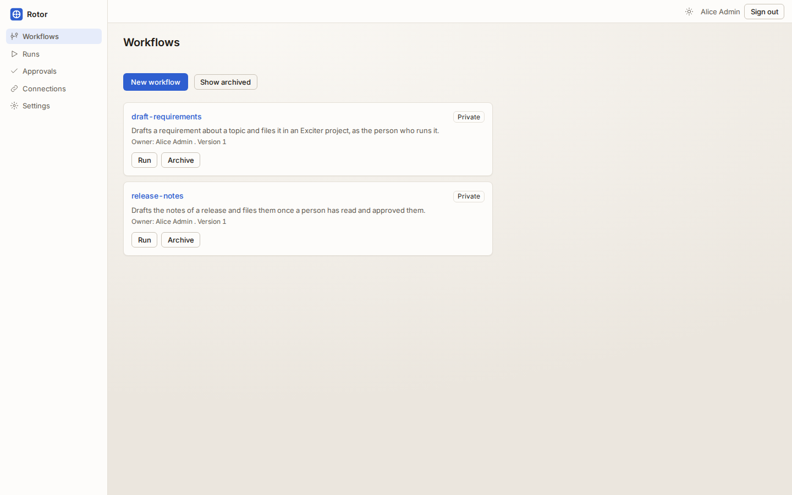
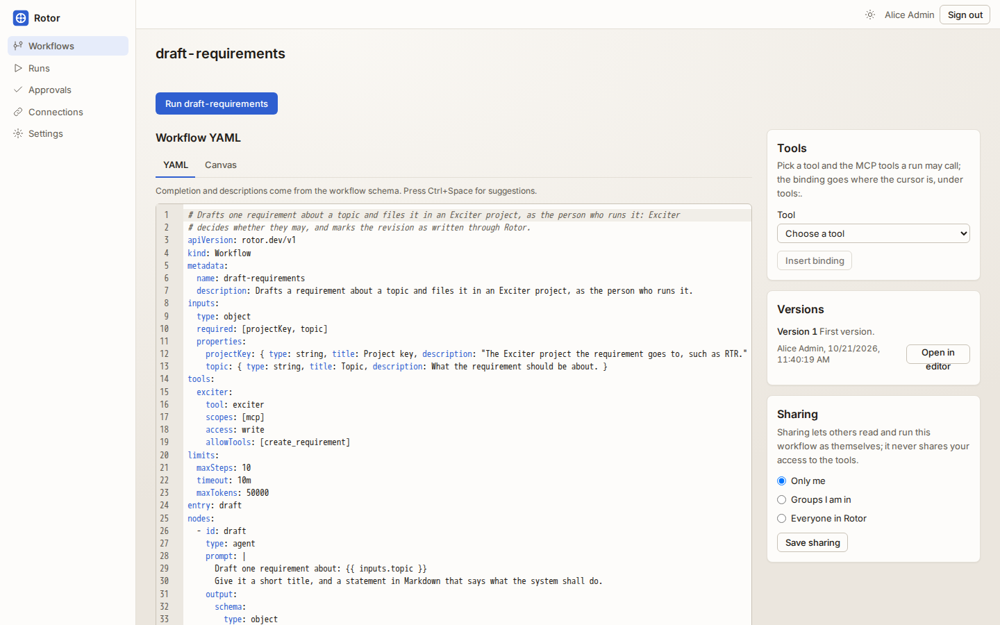
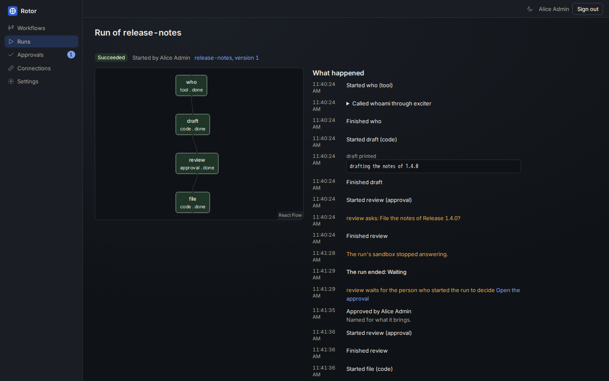
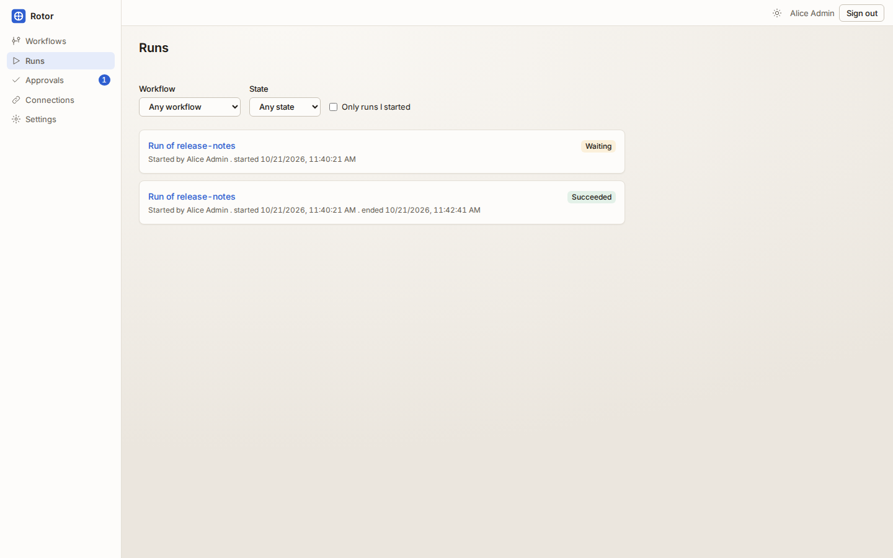
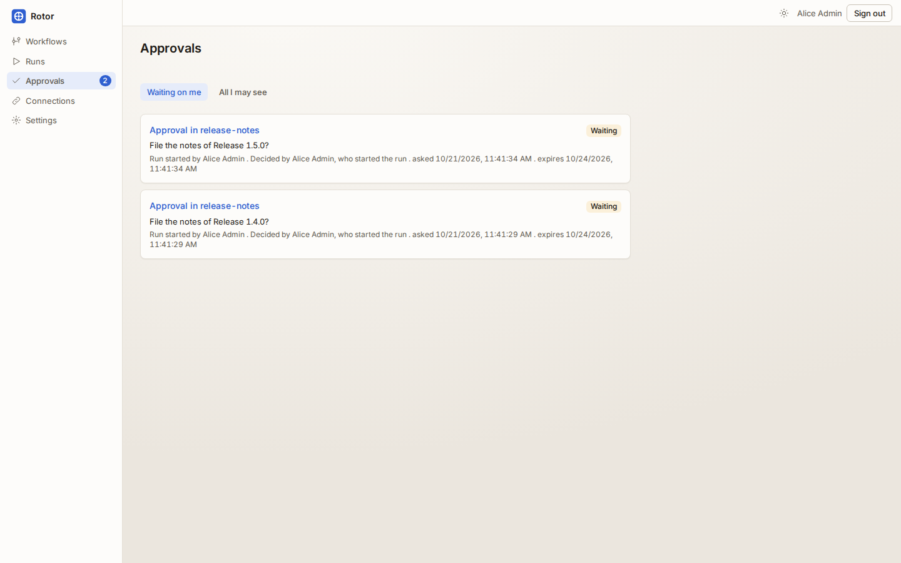
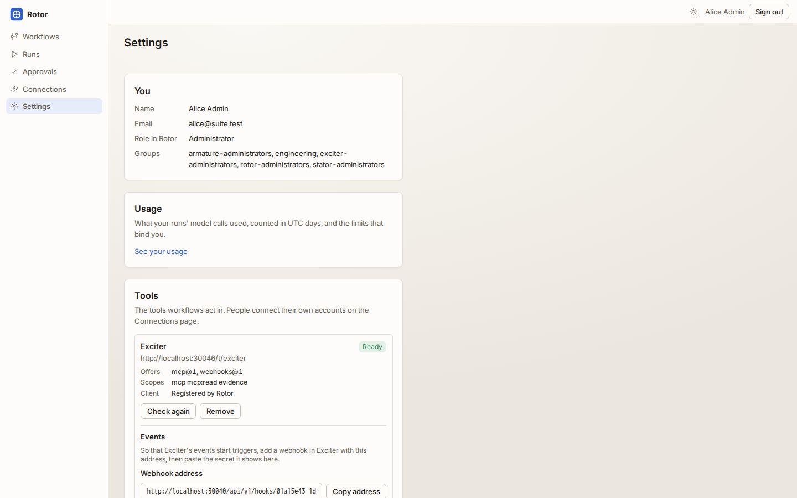
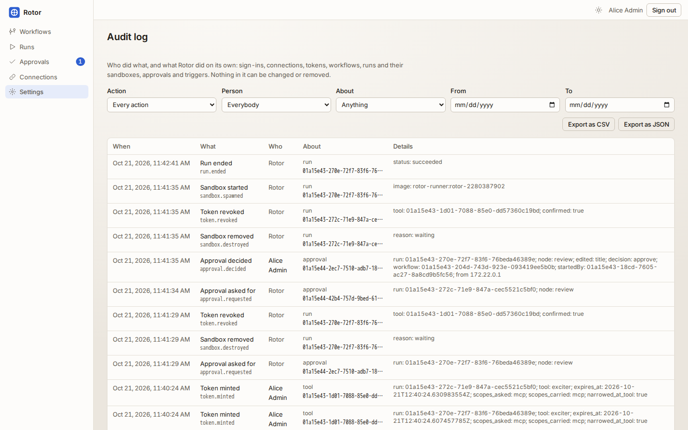

# The product, in pictures

Taken from a fresh development stack by `make screenshots`, which drives the
browser suite's own image against it as a person would: it adds the tool stub
as Exciter and its stub model, connects alice, saves
[`examples/draft-requirements.yaml`](../examples/draft-requirements.yaml) and a
workflow of its own, and carries two runs to an approval, approving one. The
spec is [`e2e/screenshots/product.spec.ts`](../e2e/screenshots/product.spec.ts),
outside the gate's browser suite.

They are taken, not edited: if one of these is wrong, the page changed. Each
picture waits for what its name promises, and one that cannot be taken fails
the run. To take them again:

```sh
make clean up
make screenshots
```

## Workflows





## Runs





## Approvals




## Tools, assistants and the record





